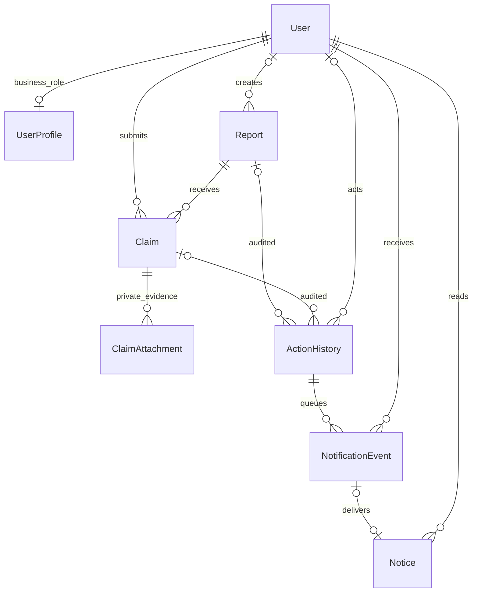

# Backend schema

Core models reuse Django User, Report, Claim and Notice. Notice is the
notification entity; NotificationEvent is its durable delivery outbox.

| Model | Required relationships and ownership | Deletion behavior |
| --- | --- | --- |
| UserProfile | One User; explicit service-staff authorization | Cascades with User; admin status alone grants no evidence access |
| Report | New service writes assign the acting User; owner may be null in legacy data | Owner SET_NULL; audited reports protected from ordinary deletion |
| Claim | Non-null Report and claimant User | Report CASCADE subject to audit protection; claimant PROTECT |
| ClaimAttachment | Non-null Claim; private filesystem storage | DB cascade alone is not file cleanup; retention queues explicit deletion |
| Notice | Non-null recipient User; nullable unique delivery event for legacy notices | User CASCADE; event PROTECT |
| ActionHistory | Nullable protected actor/report/claim; stable references retained | Ordinary update/delete denied; internal retention detaches or expires explicitly |
| NotificationEvent | Required history and recipient User; unique pair | Both PROTECT; delivery is independently retryable |

Category is an administrator-maintained suggestion catalog. Report.category
remains nonempty text so existing names are preserved. Administering Category
uses Django model permissions and does not confer evidence access.
Report.event_time is nullable only to preserve unknown legacy times; new
submissions and PUT require it. event_date/event_time use campus local time.

Report.closed_at and Claim.finalized_at are assigned during guarded transitions.
Migration 0007 derives historical values only from matching final audit actions
or a saved physical handover completion time. Unknown values stay null and
appear in maintenance diagnostics. No historical event time is invented.
Claim.current_reason and manager-only Report.review_reason preserve active
instructions separately from expiring history. Migration 0009 copies only
applicable, unexpired recorded reasons; final evidence expiry clears these
fields and matching legacy notice bodies as well as audit freeform text.
Migration fails before tightening claimant nullability if unidentified legacy
claims exist. Operators must resolve their actual owner before retrying; no
record is silently deleted or assigned an arbitrary account.

Retention clocks: final evidence text/files 15 days from finalized_at; final
claims 30 days from finalized_at; closed reports 30 days from closed_at; audit
history 45 days from created_at. Active evidence is retained, including final
evidence held while the same item is under dispute or uncertain handover.
Ordinary audit protections remain in place. Restricted maintenance removes
raw proof and copied freeform reasons, detaches protected references, and
deletes expired notices/outbox dependencies without cascading into active data.

StorageLedger serializes byte reservations and preserves charges for files
awaiting deletion. FileDeletion stores retryable disk work; completed jobs
discard original filenames and expire after 45 days. ResourceLease prevents
concurrent matching jobs and enforces cooldown. These support models do not
replace the four core business entities.
